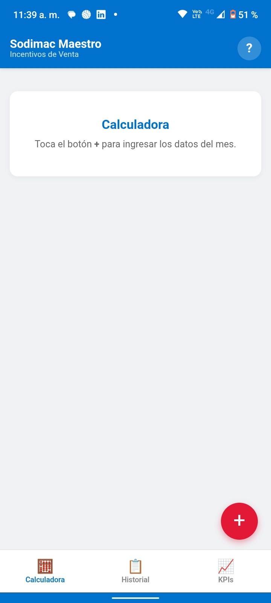
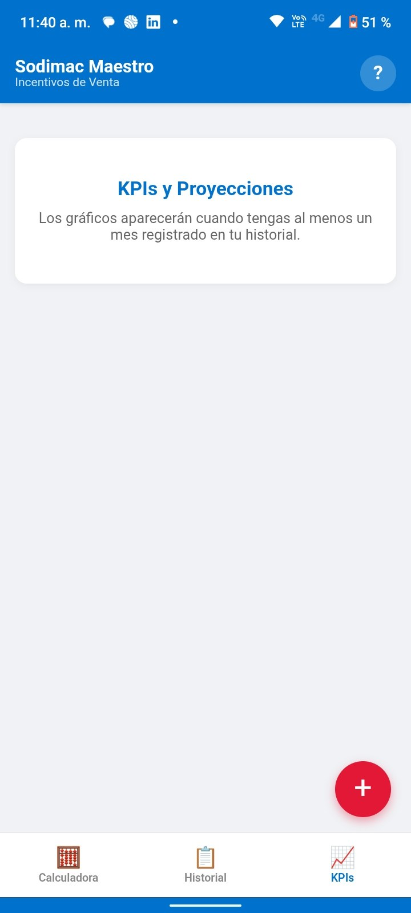

# 📖 Manual de Usuario: Calculadora Maestrazo

> [!NOTE]
> Este manual está diseñado para leerse en **menos de 3 minutos**. Si te pierdes, toca el botón **`?`** en la App.

## 🟢 1. Calcular tu Bono del Mes

  

1. Toca el botón rojo **`+`**.
2. Llena los datos de tu tienda (Plan Venta, NPS, NSR).
3. Llena tus datos personales (Venta Individual, Grupal, B-O, VE).
4. Indica si tuviste ausencias (¡Ojo! Más de 3 faltas anulan el bono).
5. Toca **"Calcular y Guardar"**.

> [!IMPORTANT]
> **El Tope del 100%:** Si en B-O o VE pusiste más de 100% (ej. 114%), el sistema lo tomará como 100% para el cálculo, tal como dicen las reglas.

## 📋 2. Revisar el Historial

  

*   Ve a la pestaña **Historial** (el ícono de la libreta).
*   **Ver Detalle:** Toca una tarjeta para ver cómo se calculó exactamente.
*   **Editar:** Si te equivocaste en un número, toca el detalle y luego "Editar Datos".
*   **Eliminar:** Desliza la tarjeta hacia la izquierda y toca el botón rojo.

## 📈 3. Ver tus Gráficos (KPIs)

  

*   Ve a la pestaña **KPIs** (el ícono de la gráfica).
*   Verás tus totales, promedios y un gráfico que compara tus bonos (barras azules) con tu cumplimiento (línea roja).

## 📤 4. Exportar e Importar (Excel)

  

*   **Exportar:** Guarda un respaldo en tu PC descargando el archivo Excel.
*   **Importar:** Si tienes un Excel con tus datos, súbelo para que la App calcule todo automáticamente.

---

# 📚 Anexo Técnico: Reglas Originales y Ejemplo de Cálculo

*(Mantén todo el contenido del anexo que te envié en el mensaje anterior: Tablas, ejemplo, advertencias del PDF, etc.)*

> [!WARNING]
> **Nota para el equipo:** Esta sección documenta las reglas extraídas del PDF oficial de Sodimac. También expone **errores de tipeo y datos faltantes** que el documento original tiene, y cómo esta App los ha resuelto.

## 📊 Tabla 1: Premio Base (Según Cumplimiento Ponderado)
El cumplimiento ponderado se calcula: `(50% Venta Individual) + (50% Venta Grupal)`.

| Cumplimiento Ponderado | Premio Base (S/) |
| :--- | :--- |
| 90% - 94.9% | S/ 0 |
| 95% - 99.9% | S/ 100 |
| ... | ... |
| **115% - 119.9%** | **S/ 850** *(Ejemplo)* |

## 🔄 Tabla 2: Factor Multiplicador
Depende del cumplimiento de la **Frecuencia de Compra de Clientes Black & Oro (B-O)**.

| Cumplimiento Frecuencia B-O | Multiplicador |
| :--- | :--- |
| 80% - 99.9% | 1.0 |
| 100% - 104.9% | 1.1 |
| ... | ... |

## 🧮 El Ejemplo de Cálculo (Página 3 del PDF original)

### 📝 Los Datos del Problema (Lo que dice el texto)
*   Plan de Ventas Tienda: **> 100%** (asumimos 101%)
*   NPS: **101%**
*   NSR: **101%**
*   Venta Individual: **117%**
*   Venta Grupal (Módulo): **115%**
*   Frecuencia de Compra B-O: **107%**

> [!CAUTION]
> **Errores y Datos Ocultos del PDF Original:**
> 1. **Falta de información:** El problema NO menciona el % de B-O Retail ni el % de VE en el texto principal. Sin embargo, en la resolución mágicamente aparecen: **B-O Retail = 114%** y **VE = 30%**.
> 2. **Error de Tipeo:** El texto dice que la Frecuencia B-O es 107%. Si vamos a la Tabla 2, 107% debería dar un multiplicador de **1.15**. Pero en la resolución del PDF usan **1.1** (como si fuera 104%). Es un error de tipeo del documento original.

---

### 🧮 La Resolución Paso a Paso (Como debía ser)

#### PARTE 1: Incentivos Fijos de Tienda
*   Plan de Tienda (>100%): **S/ 100**
*   NPS (101%): **S/ 50**
*   NSR (101%): **S/ 50**
*   **Subtotal Tienda: S/ 200.00**

#### PARTE 2: El Cálculo del Maestrazo
**Paso A: Cumplimiento Ponderado**
`(117% * 0.50) + (115% * 0.50) = 58.5% + 57.5% =` **116%**
*(Con 116%, buscamos en la Tabla 1 y nos da un Premio Base de **S/ 850**).*

**Paso B: Aplicar el Multiplicador**
*   Según el texto, la frecuencia es 107%, lo que debería dar **1.15**.
*   Pero siguiendo la resolución del PDF (que usó 104%), usaremos **1.1**.

**Paso C: Cálculo B-O Retail (80% del premio)**
*   El PDF usa 114%, pero por la regla del tope, se calcula con 100%.
*   `S/ 850 * 100% (Tope) * 80% (Peso) * 1.1 (Multiplicador) =` **S/ 748.00**

**Paso D: Cálculo VE - Venta Empresa (20% del premio)**
*   El PDF usa 30% (dato oculto).
*   `S/ 850 * 30% * 20% (Peso) * 1.1 (Multiplicador) =` **S/ 56.10**

*   **Subtotal Maestrazo:** `748.00 + 56.10 =` **S/ 804.10**

#### PARTE 3: Total Final
*   Total Tienda + Total Maestrazo = `200.00 + 804.10 =` **S/ 1,004.10**