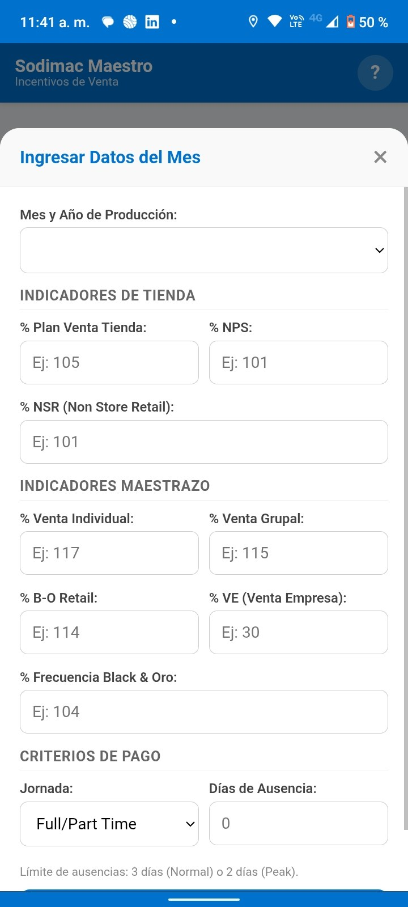
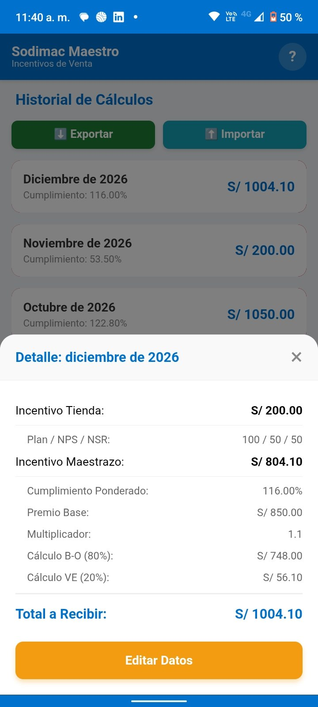
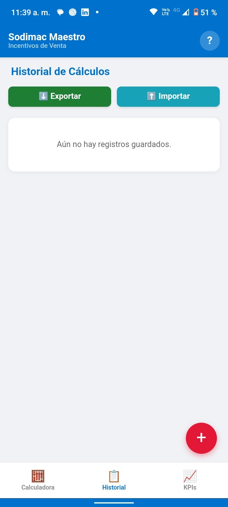
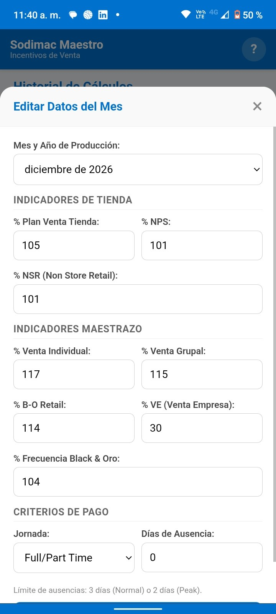
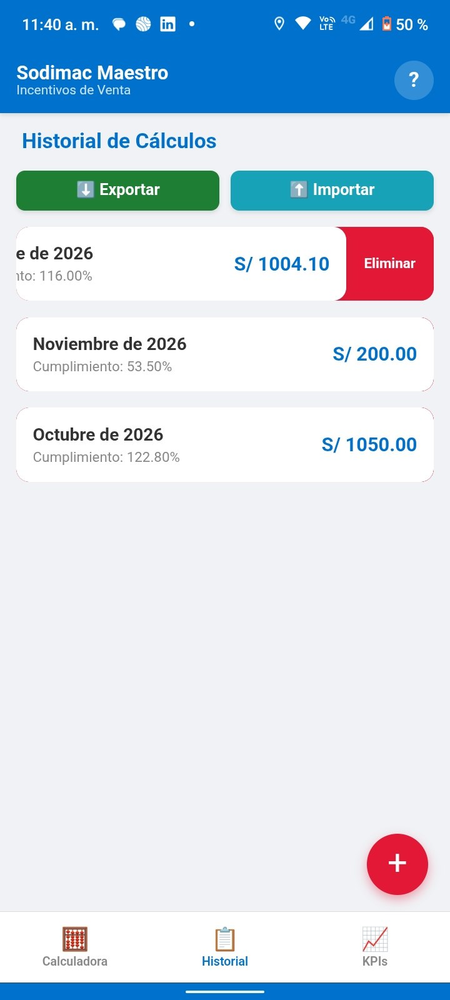
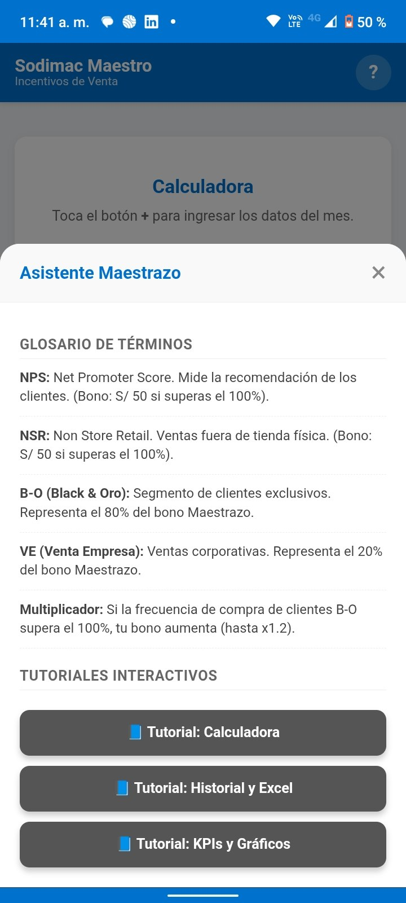
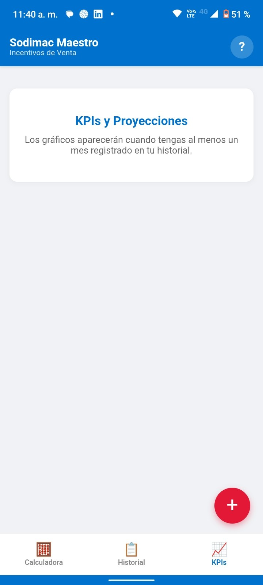

# 📖 Manual de Usuario: Calculadora Maestrazo

Guía paso a paso para usar la **Calculadora Maestrazo**. Diseñada para leerse rápido.

[⬅️ Volver al README](./README.md)

---

## 📑 Contenido

1. [🧮 Calcular tu bono](#-calcular-tu-bono)
2. [🗂️ Ver el historial](#️-ver-el-historial)
3. [✏️ Editar un registro](#️-editar-un-registro)
4. [🗑️ Eliminar con swipe](#️-eliminar-con-swipe)
5. [🎓 Usar el asistente](#-usar-el-asistente)
6. [📊 Ver tus KPIs](#-ver-tus-kpis)
7. [📥 Exportar e importar Excel](#-exportar-e-importar-excel)
8. [📖 Glosario de Términos](#-glosario-de-términos-y-nomenclaturas)
9. [🔧 Anexo Técnico](#-anexo-técnico)

---

## 🧮 Calcular tu bono

1. 📝 Abre la app y ve al formulario (toca el botón rojo **+**).
2. 🔢 Ingresa tus porcentajes: **B-O**, **VE**, **NPS** y **NSR**.
3. 📅 Indica tus ausencias del mes.
4. ✅ Presiona calcular.

*📝 El formulario de ingreso de datos.*

Verás el desglose con los montos de cada indicador y el total de tu bono.

*💰 El desglose del cálculo con montos.*

> [!TIP]
> Guarda el cálculo para que aparezca en tu historial.

---

## 🗂️ Ver el historial

Cada cálculo guardado aparece como una tarjeta por mes.

*🗂️ La lista de meses guardados.*

Toca una tarjeta para ver su detalle.

---

## ✏️ Editar un registro

1. 👆 Abre el mes que quieres corregir.
2. ✏️ Toca el botón de **editar**.
3. 🔢 Cambia los valores.
4. 💾 Guarda los cambios.

*✏️ La pantalla de edición.*

> [!NOTE]
> El bono se recalcula solo con los nuevos valores.

---

## 🗑️ Eliminar con swipe

Desliza la tarjeta del mes hacia un lado para eliminarla.

*🗑️ Desliza la tarjeta para eliminar.*

> [!WARNING]
> Eliminar un registro no se puede deshacer. Si dudas, exporta tus datos a Excel antes.

---

## 🎓 Usar el asistente

El asistente reúne el **glosario** y los **tutoriales** de la app.

*🎓 El asistente con glosario y tutoriales.*

Úsalo cuando no recuerdes qué significa un indicador (B-O, VE, NPS, NSR).

---

## 📊 Ver tus KPIs

El dashboard muestra tu evolución con gráficos de barras y líneas.

*📊 El dashboard de KPIs.*

Sirve para ver si estás mejorando mes a mes.

---

## 📥 Exportar e importar Excel

- 📤 **Exportar:** descarga tu historial en un archivo `.xlsx`.
- 📥 **Importar:** carga un archivo `.xlsx` para recuperar tus datos.

> [!TIP]
> Exporta una copia de vez en cuando. Tus datos viven solo en tu dispositivo.

---

## 📖 Glosario de Términos y Nomenclaturas

> [!TIP]
> **¿Te olvidaste de qué significa algo?** Aquí tienes el diccionario de la App explicado de forma sencilla.

### 🏢 Términos de Sodimac (El Negocio)

Estos son los indicadores que te da la empresa y que debes ingresar en la calculadora.

| Término | Significado | ¿Cómo te afecta en el bono? |
| :--- | :--- | :--- |
| **🧮 Plan Venta Tienda** | La meta general de ventas de toda tu tienda física. | Si la tienda llega al 100%, ganas **S/ 100** fijos. |
| **🌟 NPS** | *(Net Promoter Score)*. Mide qué tanto recomiendan los clientes la tienda. | Si superas el 100%, ganas **S/ 50** fijos. |
| **🛍️ NSR** | *(Non Store Retail)*. Ventas que se hacen fuera de la tienda física (online, etc.). | Si superas el 100%, ganas **S/ 50** fijos. |
| **👑 B-O (Black & Oro)** | Clientes exclusivos de alto valor. | Es el **80%** de tu bono Maestrazo. *(Tiene tope del 100%)* |
| **🏢 VE (Venta Empresa)** | Ventas corporativas (a empresas o constructoras). | Es el **20%** de tu bono Maestrazo. *(Tiene tope del 100%)* |

### 🧮 Términos Matemáticos (Los Cálculos)

Así es como la App transforma tus porcentajes en dinero real.

| Término | Significado | ¿Cómo te afecta en el bono? |
| :--- | :--- | :--- |
| **⚖️ Cumplimiento Ponderado** | Es tu nota final. Se calcula sumando el **50%** de tu Venta Individual + el **50%** de tu Venta Grupal. | Define en qué rango de la "Tabla de Premios" caes. |
| **💰 Premio Base** | Es el monto inicial (en Soles) que te corresponde según tu Cumplimiento Ponderado. | Puede ir desde **S/ 0** hasta **S/ 1,200**. |
| **🚀 Multiplicador** | Un número (1.0 a 1.2) que **multiplica TODO tu bono** para arriba. | Depende de tu **Frecuencia B-O**. Si es mayor a 100%, ganas hasta un 20% extra. |
| **🚫 Tope del 100%** | Es un límite matemático. | Si en B-O o VE sacaste 114%, la App lo calculará como si fuera 100%. **No te paga de más.** |
| **❌ Anulación de Bono** | Es cuando el sistema te pone un Cero (S/ 0) directo. | Ocurre si superas el límite de **ausencias** (3 días normal / 2 días Peak Time). |

### 📱 Términos de la Aplicación (La Tecnología)

Estas son las palabras "técnicas" que verás en la pantalla de tu celular.

| Término | Significado | ¿Por qué es útil? |
| :--- | :--- | :--- |
| **📱 PWA** | *(Progressive Web App)*. Es una página web que se instala en tu celular como si fuera una app de la Play Store. | No ocupa espacio en tu memoria y se abre a pantalla completa. |
| **✈️ Modo Offline** | Significa que la App funciona **sin internet**. | Puedes calcular tu bono en el almacén o en el sótano sin señal. |
| **💾 LocalStorage** | Es la "memoria interna" del navegador de tu celular. | Tus datos se guardan ahí. Son **100% privados**; nadie más los ve. |
| **📥 Importar / Exportar** | Pasar datos desde/hacia un archivo de Excel (`.xlsx`). | Te sirve para respaldar tu historial en tu PC o llevarlo a otro celular. |
| **👉 Swipe** | Es la acción de "deslizar" el dedo sobre la pantalla. | En la App, deslizar una tarjeta hacia la izquierda te permite **Eliminar** un registro. |
| **📊 KPIs** | *(Key Performance Indicators)*. Indicadores clave de rendimiento. | Son los gráficos que te muestran si estás mejorando o empeorando mes a mes. |

---

## 🔧 Anexo Técnico

### 📜 Reglas del PDF original

El cálculo sigue las reglas del documento oficial de incentivos Maestrazo.
Los indicadores considerados son **B-O**, **VE**, **NPS** y **NSR**.

### 🎯 Topes del 100%

> [!IMPORTANT]
> **B-O** y **VE** tienen un **tope máximo del 100%**.
> Aunque superes ese valor, el cálculo toma 100%.

### 🚫 Ausencias

> [!WARNING]
> Si tus ausencias **superan el límite**, el bono se anula y el resultado es **S/ 0**.

---

[⬅️ Volver al README](./README.md)