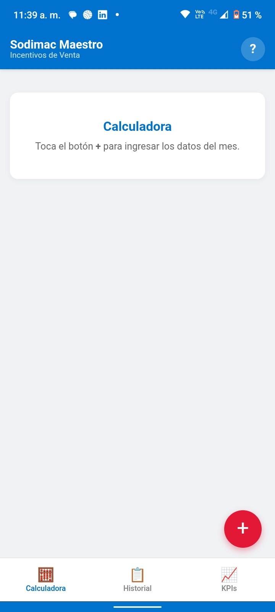
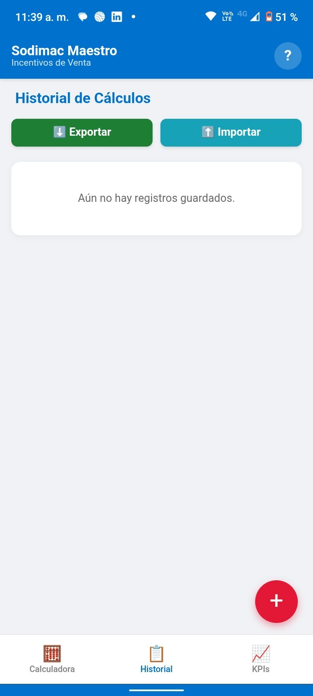
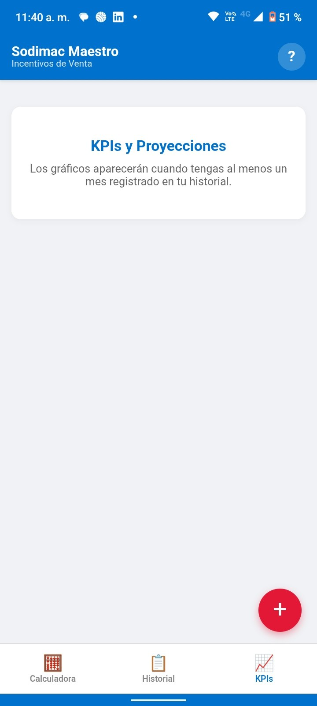
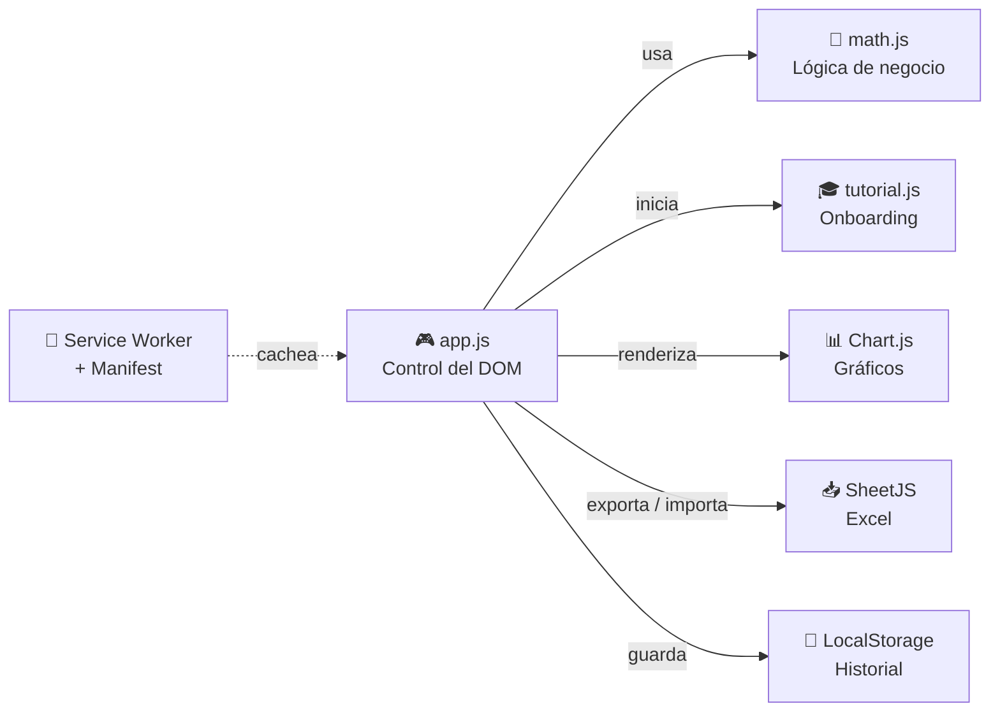

```markdown
<div align="center">

# 🧮 Calculadora Maestrazo

**Calcula, proyecta y analiza tus incentivos de venta Sodimac. Rápido, offline y sin complicaciones.**

<br>


<br>

[🌐 **Abrir la App en Producción**](https://jimmynorman.github.io/Calculadora-Maestrazo/)

</div>

---

> [!TIP]
> **TL;DR:** Una PWA para que los asesores Maestrazo de Sodimac calculen sus bonos exactos.
> Guarda tu historial, mira tus KPIs en gráficos y úsala 100% sin internet.

---

## 📸 Capturas de Pantalla

<div align="center">



*🧮 La calculadora: ingresa tus porcentajes y mira tu bono al instante.*

<br>



*🗂️ El historial: edita, elimina y revisa tus cálculos anteriores.*

<br>



*📊 El dashboard: sigue la evolución de tus indicadores con gráficos.*

</div>

---

## ✨ Características Principales

| Módulo | Descripción | Icono |
|:-------|:------------|:-----:|
| **Calculadora** | Cálculo exacto de bonos con B-O, VE, NPS y NSR. | 🧮 |
| **Historial** | Guarda tus cálculos en el dispositivo. Puedes editarlos y eliminarlos. | 🗂️ |
| **Dashboard de KPIs** | Gráficos de evolución para ver tu progreso mes a mes. | 📊 |
| **Excel** | Exporta e importa tus datos con archivos `.xlsx`. | 📥 |
| **Modo Offline** | Funciona sin conexión gracias al Service Worker. | 📴 |
| **Tutorial** | Onboarding interactivo para aprender en minutos. | 🎓 |

---

## 🚀 Instalación Rápida

1. 🌐 Abre la [app en Chrome](https://jimmynorman.github.io/Calculadora-Maestrazo/) desde tu Android o PC.

2. 📲 Toca el ícono de **Instalar** en la barra de direcciones (PC) o en el menú ⋮ → *Instalar aplicación* (Android).

3. ✅ Confirma la instalación y abre la app desde tu pantalla de inicio.

> [!NOTE]
> Después de instalarla, la app funciona sin internet.

---

## 🏗️ Arquitectura del Software

El código está dividido en **3 módulos** con responsabilidades claras:

- 🧠 **`math.js`** → Lógica de negocio y fórmulas de bonos.
- 🎓 **`tutorial.js`** → Onboarding interactivo para nuevos usuarios.
- 🎮 **`app.js`** → Control del DOM y orquestador principal.



> [!TIP]
> Toda la lógica de cálculo vive en `math.js`. Si cambian las reglas, solo tocas ese archivo.

---

## 📚 Documentación Adicional

- 📖 [**Manual de Usuario**](./MANUAL.md) → Guía paso a paso de la app.
- 🗺️ [**Roadmap**](./ROADMAP.md) → Qué viene en el futuro.
- 📝 [**Changelog**](./CHANGELOG.md) → Historial de cambios por versión.
- 🧠 [**Memoria del Proyecto**](./MEMORY.md) → Decisiones y contexto técnico.

---

## 🧠 Reglas de Negocio (Contexto)

> [!IMPORTANT]
> 🎯 El cálculo principal tiene un **tope del 100%** para **B-O** y **VE**.
>
> 🚫 Si hay **errores de ausencias**, el bono se **anula**.

---

<div align="center">

### 💙 Hecho con cariño para los Maestrazos

Si te sirvió, regálale una ⭐ al repositorio.

**¡Muchos éxitos con tus ventas!** 🚀

</div>
```